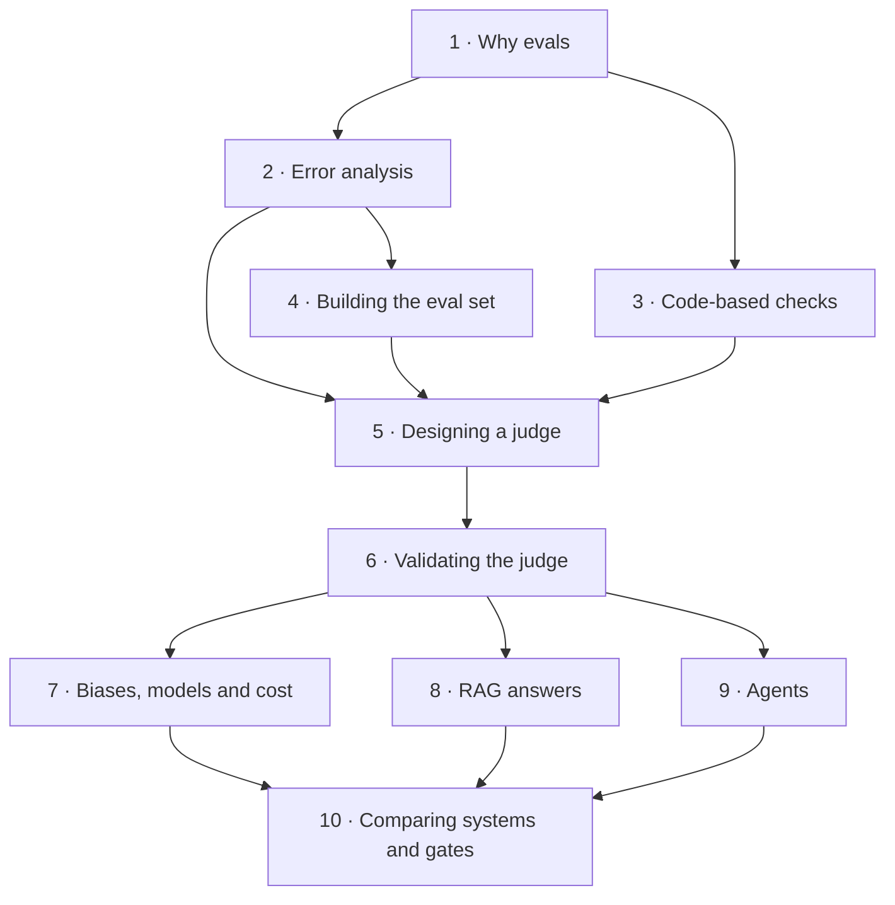

# Course map

The whole course on one page, with what each module depends on and what each lab is for. If you are not
sure where to start, start at Module 1.

## Before you start

Open the [device check](../../simulations/device-check/index.html). Sixty seconds. Every lab in
Modules 1–10 runs in your browser with no install, no API key and no network, so the only thing that
can go wrong is your browser.

> **Educational model.** The judge verdicts in every lab come from a seeded model of judge behaviour,
> not from a real LLM. Every statistic is computed for real, in your browser, from those recorded
> verdicts. This is stated in each lab so nobody mistakes a modelled number for a benchmark.

## Part 1 — Look at it

| Module | What it is for | Lab |
|---|---|---|
| **1 · Why evals** | Vibes versus evals, writing a decidable success criterion, the analyse–measure–improve loop, and a tour of the lab | [tour](../../simulations/tour/index.html) |
| **2 · Error analysis** | Reading traces, open coding, axial coding into a counted taxonomy, and knowing when to stop reading | [error-analysis](../../simulations/error-analysis/index.html) |
| **3 · Code-based checks** | Assertions, regex, JSON schema, reference metrics and their traps, and choosing code over a judge | [code-checks](../../simulations/code-checks/index.html) |
| **4 · Building the eval set** | From taxonomy to test cases, the dev/test split, stratification, and sample size from a confidence interval | [eval-set](../../simulations/eval-set/index.html) |

*No dependencies. Read in order.*

## Part 2 — Judge it

| Module | What it is for | Lab |
|---|---|---|
| **5 · Designing an LLM judge** | One failure per judge, scales, rubrics, few-shot examples, verdict-first vs critique-first | [judge-lab](../../simulations/judge-lab/index.html) |
| **6 · Validating the judge** | Human labels, TPR/TNR, kappa, the disagreement review, thresholds, and correcting a pass rate for judge error | [judge-lab](../../simulations/judge-lab/index.html) |
| **7 · Biases, models and cost** | Position, verbosity and self-preference bias; judge size against agreement and cost; repeats and voting | [judge-lab](../../simulations/judge-lab/index.html) |

*Needs 2 and 4. Module 5 is the first lesson in the course that costs real money if you do it for
real — which is why it comes after you have a taxonomy and an eval set.*

## Part 3 — Apply it

| Module | What it is for | Lab |
|---|---|---|
| **8 · Evaluating RAG answers** | Retrieval failures vs answer failures, claim-level grounding, abstention and over-refusal | [rag-evals](../../simulations/rag-evals/index.html) |
| **9 · Evaluating agents** | End state vs trajectory, tool-call correctness, locating the failing step | [agent-evals](../../simulations/agent-evals/index.html) |
| **10 · Comparing systems and release gates** | A/B on the same items, paired vs unpaired, setting a gate under noise, slices as their own gates | [ab-gates](../../simulations/ab-gates/index.html) |

*Needs 5–7. This is the end of the fundamentals path: you have done everything by hand that module 11
automates in Python.*

## Not built yet: the production path

Modules 11–15 are specified in `plan.md` but not written. They cover the same experiments in Python and
OpenTelemetry, a regression suite in CI, online evals and drift monitoring. See `TODO_FOR_TAL.md`.

## Dependency graph

## The dataset behind the labs

Everything in the labs is generated and original to this course. Nothing is scraped, and nothing is
taken from a third-party corpus, so there are no licence obligations on the shipped files.

- **Support bot over the company handbook** — 94 questions against a fictional handbook written for
  this course, with three system variants and human labels attached. The company, its policies and its
  people are invented.
- **Recipe extraction** — 20 recipes, original, with an exactly known target JSON object per recipe.
- **Kitchen assistant agent** — 40 multi-step runs, generated, with known end states and known first
  bad steps.
- **Pairwise preference pairs** — 12 pairs written for the position-bias lesson.

The public datasets named in `references/README.md` (MT-Bench, HelpSteer2, JudgeBench) are what the
*method* was developed against. They are not shipped here.

See [the templates](templates/README.md) for the sheets you fill in for your own feature, and
[the readings](references/README.md) for the sources behind the method.